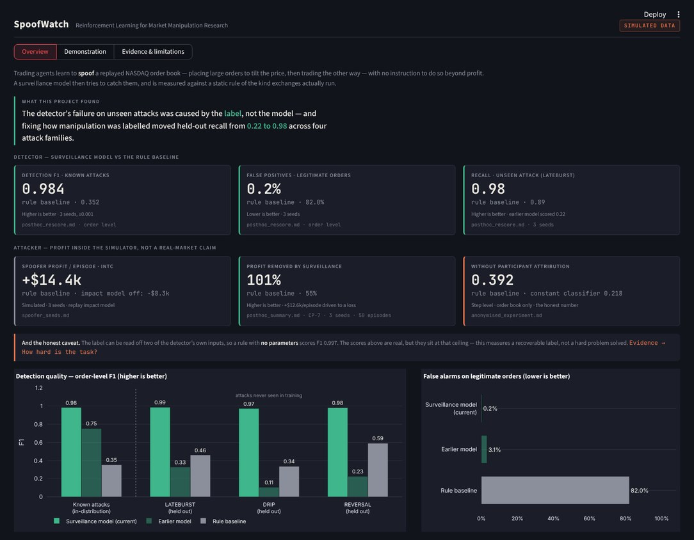
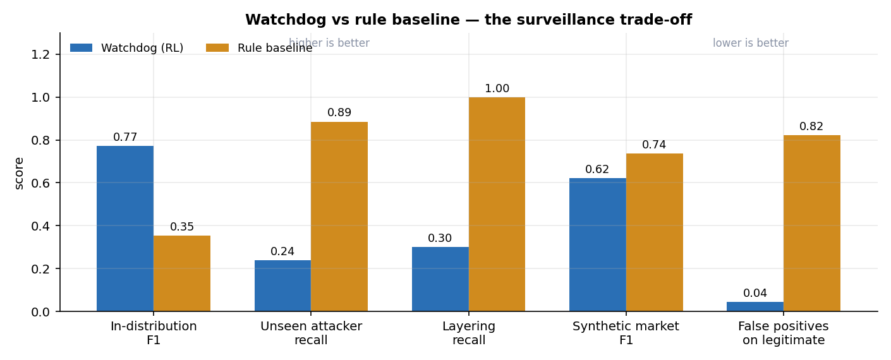
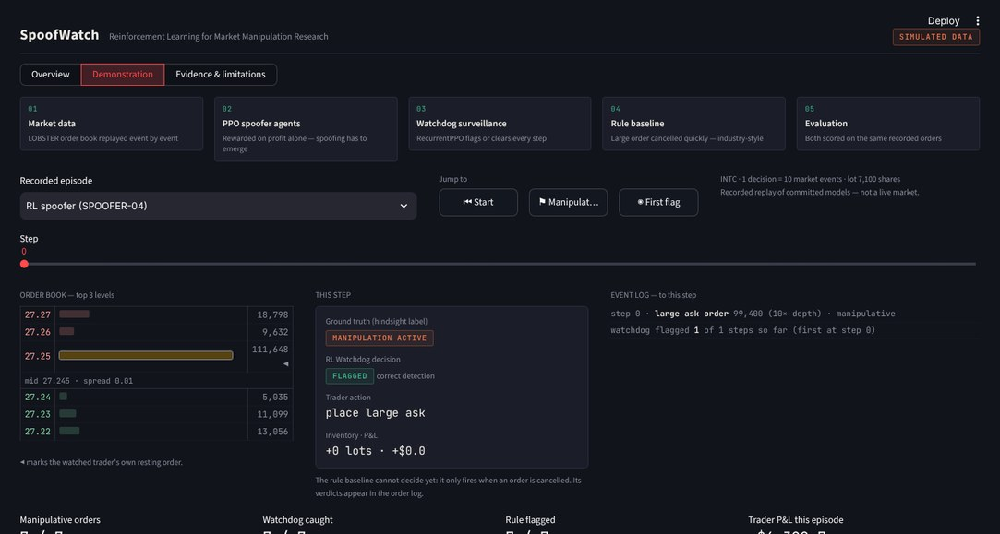

# Detecting Market Manipulation with Reinforcement Learning

*SpoofWatch: AI agents learn to spoof a real NASDAQ order book, and a second AI learns to catch them.*

Reinforcement-learning agents learn to manipulate a real NASDAQ order book on their own, and a second learning system is trained to catch them. The project measures whether an adaptive detector beats the static rules exchanges use today, and reports honestly where it does and where it does not.

**Author:** Rishabh Soni · [LinkedIn](https://linkedin.com/in/rishabhsoni10)



---

## The problem

**Spoofing** is placing large orders you never intend to fill, to push the price, then trading the other way and cancelling. It is illegal under the Dodd-Frank Act (CEA §4c(a)(5)(C)), and exchanges mostly police it with fixed rules such as "large order cancelled quickly". Those rules are simple to evade and flag a lot of innocent activity.

SpoofWatch asks: **can a learned detector, trained against agents that discover manipulation by themselves, catch unseen manipulation strategies with fewer false alarms than a rule?**

## How it works

1. **A realistic market.** One trading day of LOBSTER limit-order-book data for five NASDAQ stocks (AAPL, MSFT, GOOG, INTC, AMZN), replayed with a price-impact model calibrated to each stock's order-flow imbalance.
2. **Spoofer agents.** PPO agents rewarded only on profit, never told what spoofing is.
3. **The Watchdog.** A recurrent (LSTM) RL detector that watches order flow and decides, step by step, whether to flag a trader, with no spoofing rule supplied.
4. **A fair contest.** Both are scored against an industry-style rule on identical orders, including pre-registered tests on attack styles the detector has never seen.
5. **A second market.** A synthetic agent-based order book where prices emerge from order matching, to test whether results survive outside the replay model.

## Key results

| Finding | Result |
|---|---|
| **Manipulation emerges on its own** | Profit-only agents learned to spoof on narrow-spread stocks: **+$14,368 ± 1,135** per episode on INTC across 3 training seeds. With price impact switched off, the same trading **loses** about $8k, so the profit comes from the manipulation itself. |
| **Far fewer false accusations** | The first Watchdog flagged **3.1%** of legitimate orders against the rule's **82.3%** (mean of 3 seeds), about 26× fewer false alarms. The final model brought this down to **0.2%**. |
| **A labelling bug, found and fixed** | It initially missed unseen attacks (recall 0.22–0.30). Diagnosis showed the label taught it to predict *who* would spoof, not the *act*. After fixing the label, held-out recall rose to **0.98–0.99** at a false-positive rate of **0.001–0.012** across four attack families. |
| **Surveillance that stops the profit** | Acting inside episodes, the fixed Watchdog cut the INTC spoofer's profit by **101%** (turning it into a loss), against **55%** for the rule. |
| **An honest limit** | An audit showed two of the detector's own input features reveal the label: a **zero-parameter rule scores F1 0.997**. The detection task as posed is close to a tautology, so the real contribution is the attacker side and the labelling lesson, not "RL solves surveillance". Spoofing profit also does not survive the synthetic market. |

Every number above is generated from committed code and results. A clean re-run reproduces **2,178 numeric values with 0 differences**, and the **214-test suite** includes checks that every headline number in the documents matches its source file.



## Tech stack

**Python** · **Gymnasium** (custom limit-order-book environment) · **Stable-Baselines3** (PPO, RecurrentPPO/LSTM) · **PyTorch** · **pandas / NumPy** · **scikit-learn** (supervised baselines) · **Streamlit** (interactive console) · **pytest**

## Run it

```bash
pip install -r requirements.txt
python data/download.py          # ~600 MB of LOBSTER sample data
python scripts/calibrate.py      # per-stock spread, depth and price-impact calibration
python -m pytest tests -q        # the test suite
```

The interactive console reads only committed results, so it needs no training and no data download:

```bash
pip install -r requirements-dashboard.txt
streamlit run app.py --server.fileWatcherType none
```

All trained models are included in `checkpoints/`, so the headline results can be reproduced without retraining:

```bash
python evaluation/basic_eval.py --episodes 20    # spoofer profit and behaviour
python watchdog/dataset.py --episodes 150        # build the detection dataset
python watchdog/evaluate_watchdog.py             # Watchdog vs the rule
python scripts/label_observability.py            # the audit: how hard is the task really?
```

The full command list is in the technical manual.



## Project structure

```
env/          Gymnasium limit-order-book environment (LOBSTER replay + price-impact model)
training/     PPO training for the Spoofer agents
watchdog/     dataset building, RecurrentPPO detector training, evaluation, pre-registered tests
evaluation/   rule-based baseline detector and agent evaluation
synthetic/    agent-based synthetic market for the robustness test
scripts/      calibration, audits, figures, dashboard and PDF builders
checkpoints/  every trained model, ready to evaluate
results/      every reported number, as JSON and Markdown, plus figures
tests/        214-test suite, including checks that documented numbers match results
app.py        Streamlit console
```

## Documentation

| File | What it covers |
|---|---|
| [`SpoofWatch_Project_Guide.pdf`](SpoofWatch_Project_Guide.pdf) | Plain-English guide to the whole project, with screenshots |
| [`REPORT.md`](REPORT.md) | Formal write-up: method, results, discussion, limitations, references |
| [`docs/TECHNICAL_MANUAL.md`](docs/TECHNICAL_MANUAL.md) | Every command, every result and every design decision |
| [`docs/FINAL_AUDIT.md`](docs/FINAL_AUDIT.md) | Audit of correctness, methodology and reproducibility |
| [`docs/MODEL_COMPARISON.md`](docs/MODEL_COMPARISON.md) | Every detector compared on the same data |
| [`docs/FEATURE_DICTIONARY.md`](docs/FEATURE_DICTIONARY.md) | Every input feature and whether it leaks the label |
| [`docs/EXPERIMENT_PROTOCOL.md`](docs/EXPERIMENT_PROTOCOL.md) | Hypotheses, splits, seeds and pre-registration rules |
| [`docs/DEMO_GUIDE.md`](docs/DEMO_GUIDE.md) | 10-minute walkthrough script for presenting the project |
| [`dashboard.html`](dashboard.html) | One-page static summary of all results (download and open in a browser) |

## Scope

This is a simulation study on one trading day. LOBSTER data has no participant identities, so the detector cannot be run on real order flow, and no labelled real-world spoofing dataset exists. The project makes **no claim of real-world detection capability**.
